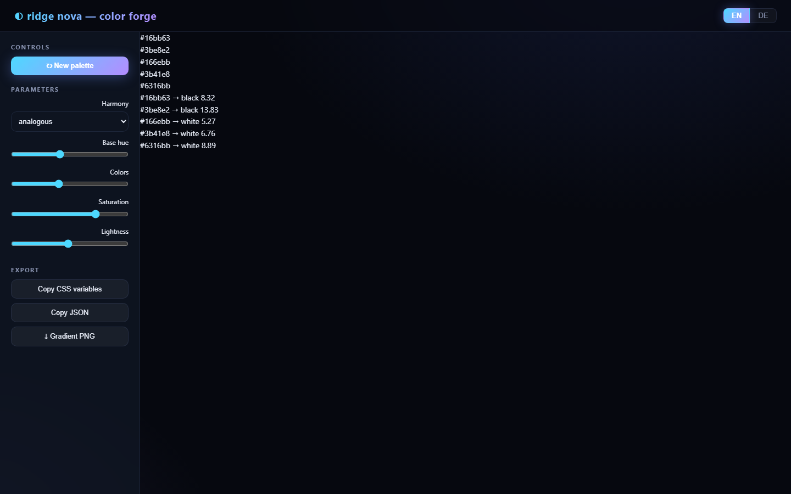
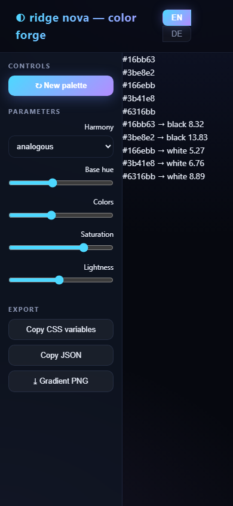

# Ridge Nova — Color Forge

A analogous color harmony generator with saturation/lightness controls, contrast ratios, one-click hex copy and CSS/JSON/PNG export.

<div align="center">


**[Live Demo](https://ruslanfridenli.github.io/ridge-nova/)** · **[Deutsch ↓](#-deutsch)**

</div>

---

## Screenshots






## Features

- Five color harmony algorithms
- Live contrast ratio readout
- Click any swatch to copy hex
- Export CSS variables, JSON or gradient PNG
- Fully responsive layout
- English/German interface

## Local development

```bash
git clone https://github.com/ruslanfridenli/ridge-nova.git
cd ridge-nova
# open index.html in a browser, or serve statically:
npx serve .
```

No build step, no dependencies — pure static site.

---

## 🇩🇪 Deutsch

### Ridge Nova — Farbforge

Ein analogous-Farbharmonie-Generator mit Sättigungs-/Helligkeitsreglern, Kontrastwerten und CSS/JSON/PNG-Export.

### Funktionen

- Fünf Farbharmonie-Algorithmen
- Live-Kontrastanzeige
- Swatch anklicken kopiert Hex
- Export als CSS-Variablen, JSON oder Verlaufs-PNG
- Vollständig responsives Layout
- Englische/deutsche Oberfläche

### Lokale Entwicklung

```bash
git clone https://github.com/ruslanfridenli/ridge-nova.git
cd ridge-nova
npx serve .
```

Reine statische Seite — kein Build-Schritt, keine Abhängigkeiten.

---

## ☕ Support / Unterstützen

Wenn dir diese Website beim Lernen hilft, würde mir eine Spende sehr viel bedeuten und dabei helfen, sie weiterzuentwickeln. Alternativ kannst du das Projekt mit einem Stern im github repo unterstützen. Vielen Dank!

- Solana: `zQpgZ6nGigww7vYpz3Qqxb1BT44kqS567vFaLTeHagS`
- Ethereum: `0x9c4fE1B2e9a1A9c22312c8296BB088Ca0e8F1B4e`
- Bitcoin: `bc1p2jltk9ya9kyzv35d8kxn7mmg9jqkx66cqtgzqwe75zlr4v9jk4hsv468q7`

---

Made with care. Feedback welcome via issues.
